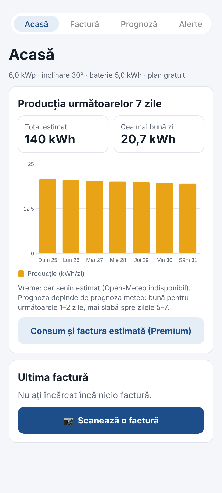
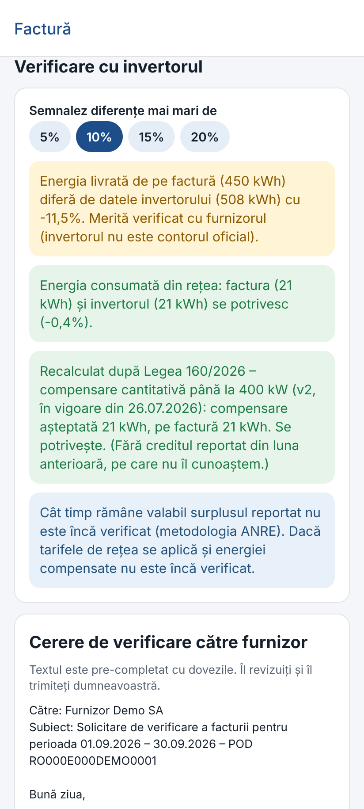
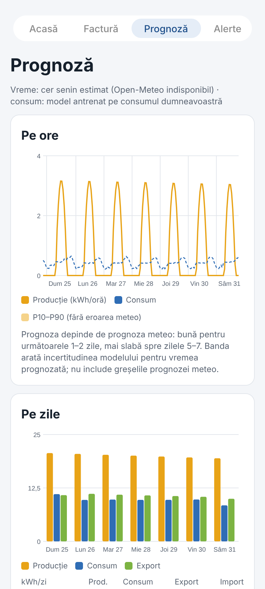

# Asistent Prosumator — Innovation Labs 2026

**Asistent Prosumator** is a web and mobile prototype designed to help Romanian household solar prosumers understand electricity bills, compare them with inverter readings, forecast energy production and consumption, and evaluate possible photovoltaic system upgrades.

Built collaboratively during an innovation hackathon / AI Validation Bootcamp challenge. This portfolio version documents a **co-developed team project**, with the interface in Romanian and documentation in English.

> **Prototype notice:** The demo household and sample bills are synthetic. Forecasts, installation costs, compensation calculations and legal explanations are estimates or unverified assumptions, not financial or legal advice.

## Highlights

- **Electricity bill analysis:** extracts fields from PDF invoices or photographed/scanned bills, explains individual charges and allows corrections before saving.
- **Invoice verification:** compares billed energy with inverter readings, flags discrepancies and prepares a draft supplier inquiry.
- **Solar and consumption forecasts:** combines weather data, photovoltaic physics and learned corrections to estimate the next seven days, including an uncertainty range.
- **System planning:** simulates photovoltaic capacity, battery storage and household appliances; compares energy flows, indicative costs and different payback scenarios.
- **Regulatory updates:** displays versioned compensation assumptions and can demonstrate personalized notifications about rule changes.
- **Web and mobile interfaces:** Streamlit for browsers, and a React Native / Expo mobile client connected through FastAPI.
- **Demo account:** explore the app without real inverter hardware, customer bills, Stripe credentials or a paid database.

The optional **19 RON/month Premium offer is a pricing hypothesis for testing**, not a validated subscription price. Without Stripe credentials, the demo account can unlock Premium features without payment.

## Screenshots

The mobile app includes representative screenshots:

| Home dashboard | Invoice review | Solar forecast |
| --- | --- | --- |
|  |  |  |

## Technology stack

| Layer | Main technologies |
| --- | --- |
| Web UI | Python, Streamlit, Altair |
| REST API | FastAPI, Uvicorn |
| Mobile UI | React Native, Expo Router, TypeScript |
| Processing and models | Pandas, NumPy, scikit-learn, pvlib |
| Weather and solar reference | Open-Meteo, PVGIS |
| Invoice extraction | pdfplumber, Tesseract OCR, pypdfium2 |
| Persistence | SQLite (default locally), PostgreSQL (optional) |
| Notifications and billing | ntfy, optional Stripe test mode |
| Reproducible services | Docker, Docker Compose |

## Project structure

The paths below are **relative to `Innovation_Labs_2026/`**, not to the portfolio repository root.

```text
Innovation_Labs_2026/
├── app/                 Streamlit pages and shared UI helpers
├── api/                 FastAPI endpoints for the mobile app
├── mobile/              React Native / Expo client and screenshots
├── engine/              Weather, solar, load and planning models
├── ingest/              Inverter data format detection and normalization
├── bills/               PDF/OCR extraction, validation and bill checks
├── rules/               Versioned compensation assumptions and explanations
├── alerts/              Notification delivery and rule-change messages
├── billing/             Optional Stripe test checkout
├── db/                  Models, queries and demo-data seeding
├── data/demo/           Synthetic invoice and inverter examples
├── jobs/                Optional background-job entry points
├── scripts/             Demo generation and maintenance utilities
├── tests/               Python test suite
├── .streamlit/          Web UI configuration and secrets example
├── Dockerfile           Web container
├── Dockerfile.api       API container
├── docker-compose.yml  Web + API + PostgreSQL
└── README.md            This guide
```

## Quick start: web application (Windows)

Install **Python 3.12**. Open PowerShell **inside `Innovation_Labs_2026/`** and run:

```powershell
py -3.12 -m venv .venv
.\.venv\Scripts\Activate.ps1
python -m pip install --upgrade pip
python -m pip install -r requirements-api.txt
python -m streamlit run app/Home.py
```

If PowerShell blocks virtual-environment activation, run `Set-ExecutionPolicy -Scope Process Bypass` and activate again. Open **http://localhost:8501**.

For PDF files containing selectable text, Tesseract is not required. To process photographs or scanned PDFs, install **Tesseract OCR** with Romanian language data and make its executable available on `PATH`.

### Linux / macOS

With Python 3.12 available:

```bash
python3.12 -m venv .venv
source .venv/bin/activate
python -m pip install -r requirements-api.txt
python -m streamlit run app/Home.py
```

On supported Linux distributions, `./install.sh` also installs system dependencies, including OCR tools. Review the script before running it; it may install system-wide packages.

### First launch and demo credentials

Without `DATABASE_URL`, the app creates **`data/app.db` (SQLite)** locally. This generated file is excluded from Git. On first launch, the app creates a fictional Bucharest household with approximately one year of synthetic hourly readings and trained forecasting models.

- **Demo email:** `demo@prosumer.demo`
- **Demo password:** `demo1234`
- **Shortcut:** select **“Intră în contul demo”** on the login screen.

No Supabase project, real inverter account or Stripe setup is needed for this local demo.

## Suggested demonstration workflow

1. **Log in** with the demo account; the fictional installation uses **6 kWp of panels** and a **5 kWh battery**.
2. **Facturi:** upload `data/demo/factura_demo_2026-09.pdf`, check the extracted lines, then select **“Confirmă și salvează”**.
3. **Abonament:** select **“Activează Premium pentru demo (fără Stripe)”** to enable demo-only Premium features.
4. **Facturi:** inspect the flagged differences between the invoice and the inverter data, and review the draft supplier inquiry.
5. **Prognoză:** review seven-day hourly forecasts, consumption, energy imports/exports and the indicative monthly bill estimate.
6. **Date invertor:** import `data/demo/demo_inverter_export.csv`; inspect the column mapping and optionally train the models again.
7. **Plan sistem:** add appliances (for example, an electric vehicle), then compare simulated panel and battery recommendations.
8. **Reguli & alerte:** simulate a fictional rule change. The alert is saved locally; external push delivery requires a working ntfy connection.

The included demo invoice and export are intentionally artificial and must not be presented as a real customer's records.

## API for the mobile application

Activate the Python virtual environment in the project directory and run:

```bash
python -m uvicorn api.main:app --reload --host 0.0.0.0 --port 8000
```

- Health check: **http://localhost:8000/health**
- Interactive API documentation: **http://localhost:8000/docs**
- Both web and API use the same local SQLite database by default when started from this project.

The API provides routes for authentication, installation profiles, invoice uploads and checks, inverter readings, forecasts, devices, system plans, alerts and demo subscriptions.

## Mobile application

Install **Node.js 22**, and keep the API running in a separate terminal.

```bash
cd mobile
npm ci
```

Copy `.env.example` to `.env`, then configure `EXPO_PUBLIC_API_URL` for the address reachable by the phone. Example:

```dotenv
EXPO_PUBLIC_API_URL=http://192.168.1.100:8000
```

Replace `192.168.1.100` with your computer's actual LAN IP; use `http://10.0.2.2:8000` for an Android emulator. Then:

```bash
npx expo start
```

Open the project with Expo Go while the phone and computer are connected to the same Wi-Fi network. See **[mobile/README.md](mobile/README.md)** for Android-specific setup, tests and build notes.

## Automated tests

Run from `Innovation_Labs_2026/` with the Python environment activated:

```bash
python -m pip install pytest httpx ruff
python -m pytest -q
```

Mobile checks:

```bash
cd mobile
npm ci
npm run typecheck
npm run lint
npm test
npx expo export --platform android
```

Some tests use mocked external services. Passing these checks does not imply independent verification of weather forecasts, real supplier invoices or legal compensation rules.

## Docker (optional)

From `Innovation_Labs_2026/`:

```bash
docker compose up --build -d
```

This starts **PostgreSQL**, the **Streamlit app** on port **8501** and the **FastAPI service** on port **8000**. Docker uses its own PostgreSQL database instead of the default SQLite file. These container credentials are intended for local development, not public deployment.

## Important limitations

- **Demonstration data is synthetic**; accurate results for a real household require appropriately mapped historical inverter measurements.
- **Invoice parsing** includes a fictional demo supplier and a generic fallback. Real supplier templates need validation and refinement.
- **Inverter import** can guess column mappings but may require manual mapping for unfamiliar exports.
- **Regulatory assumptions** are stored in `rules/versions/`; some are explicitly marked `verified: false` and must be checked against current official legislation and methodologies before real use.
- **System planning** uses simplified energy storage models, indicative prices and scenario assumptions. It does not fully model shading, roof geometry, electrical connection limits or installer quotes.
- **Forecast performance** depends on weather forecasts, measurements and the availability of external services.
- **Security and payments** are prototype-oriented. Deploying a real product would require hardened authentication, secrets management, data protection and payment operations.
- **Scheduled jobs:** scripts in `jobs/` are included, but **GitHub Actions workflows are not configured in this portfolio subdirectory**. No automatic recurring tasks run just because these files are present.

## Development context

This is a **collaboratively developed hackathon project**. The portfolio entry describes the shared application and its technical components; it does not assign individual ownership of specific modules to any teammate. The project is preserved here as a demonstration of hands-on product development, technical integration and testing.
