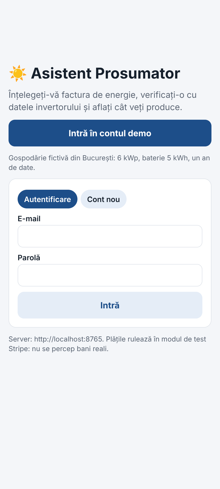
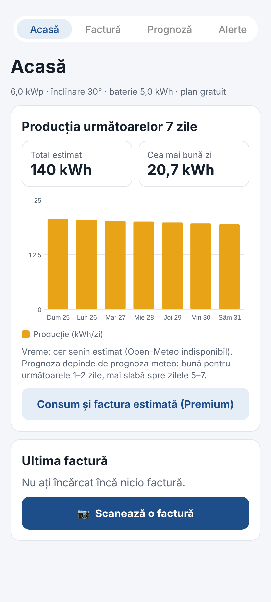
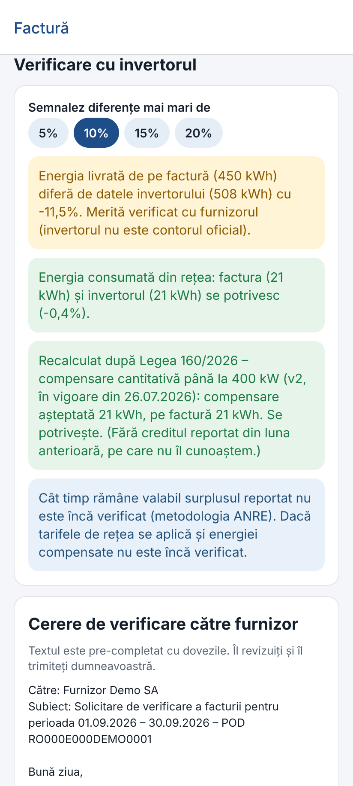
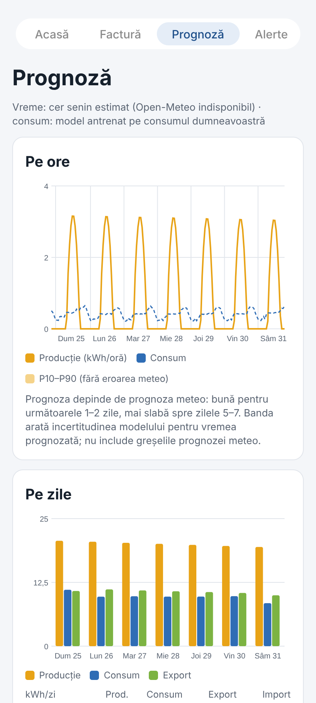
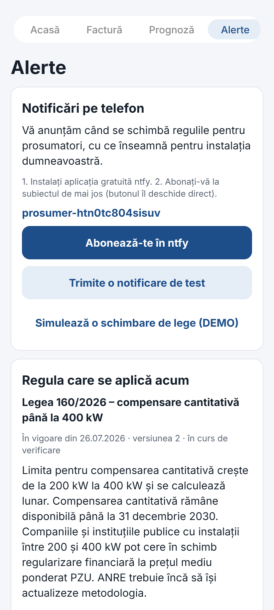
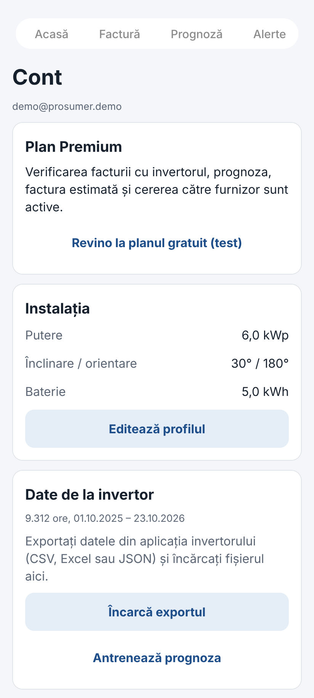

# Asistent Prosumator — Mobile Application

An **Expo / React Native** mobile client for the co-developed **Innovation Labs 2026 — Asistent Prosumator** prototype. The mobile interface is in Romanian; this documentation is in English.

The app uses **Expo SDK 58, React Native 0.88, Expo Router, and TypeScript** and communicates with the Python **FastAPI backend** in [`../api/`](../api/). The web and mobile apps use the same backend data and domain logic.

## Main screens

| Screen | Capabilities |
| --- | --- |
| **Acasă (Home)** | Solar production overview, latest invoice, alerts and access to system planning. |
| **Factură (Invoice)** | Capture a photo, choose an image or upload a PDF; review and save extracted invoice details. |
| **Prognoză (Forecast)** | Premium demonstration of hourly production/consumption, daily summaries, monthly estimate and model accuracy. |
| **Alerte (Alerts)** | Display regulatory explanations, notification history, an ntfy subscription and simulated rule changes. |
| **Cont (Account)** | Profile, inverter CSV uploads, model training, demo subscription, API server settings and logout. |
| **Plan sistem (System planning)** | Devices, suggested panel/battery configurations, energy flows and indicative payback scenarios. |

The interface also supports login/registration, an instantly available demo account, site location configuration, invoice corrections, and draft supplier inquiries.

## Screenshots

| Login | Home | Invoice analysis |
| --- | --- | --- |
|  |  |  |

| Forecast | Alerts | Account |
| --- | --- | --- |
|  |  |  |

## Requirements

- **Node.js 22** and npm.
- Python 3.12 and the backend Python dependencies from `../requirements-api.txt`.
- An Android phone with **Expo Go** or a configured Android emulator.
- The phone and development machine on the same Wi-Fi network (unless using an emulator or remotely hosted API).

## 1. Start the backend

Open a terminal in the **parent folder** (`Innovation_Labs_2026`), not in `mobile/`:

```bash
python -m pip install -r requirements-api.txt
python -m uvicorn api.main:app --host 0.0.0.0 --port 8000
```

The API should answer at **http://localhost:8000/health** and expose Swagger documentation at **http://localhost:8000/docs**.

Without `DATABASE_URL`, the local SQLite database is initialized automatically. The demo account is seeded on startup.

## 2. Configure and start Expo

Open **another** terminal in `Innovation_Labs_2026/mobile/`:

```bash
npm ci
```

Copy the included `.env.example` file to `.env`:

- Windows PowerShell: `Copy-Item .env.example .env`
- Linux / macOS: `cp .env.example .env`

Edit `.env` to set your reachable API address:

```dotenv
EXPO_PUBLIC_API_URL=http://192.168.1.100:8000
```

**Replace the example IP with your computer's LAN IPv4 address.** You can find it using `ipconfig` (Windows) or the relevant network command on Linux/macOS.

- **Physical Android device:** `http://<computer-LAN-IP>:8000` (same Wi-Fi).
- **Android emulator:** `http://10.0.2.2:8000`.
- **API on the same computer:** `http://localhost:8000` is suitable for host-based tests, not for a physical phone.

Start Expo:

```bash
npx expo start
```

Open the QR code with **Expo Go**. On the login screen, select **“Intră în contul demo”**. If the server address is wrong, it can also be changed from **Cont → Server** after login.

## 3. What to test

1. Log in using the demo account (`demo@prosumer.demo` / `demo1234`).
2. Visit **Acasă** to view the demo installation.
3. In **Factură**, choose the demo PDF or photo from `../data/demo/` and confirm its extracted details.
4. In **Cont**, activate Premium for the demo without Stripe, then check forecast and invoice comparison features.
5. Visit **Prognoză** and inspect the seven-day chart and monthly estimate.
6. Import the demo CSV under **Cont** and optionally retrain the models.
7. Open **Plan sistem**, add a device and inspect the optimization results.
8. Use **Alerte** to simulate a regulation change. Push notifications require an ntfy subscription and network access.

The demo uses synthetic data; it is not proof that a real customer's invoice is correct or that a real tariff has been independently checked.

## Tests and static build verification

Run the following in `mobile/`:

```bash
npm run typecheck
npm run lint
npm test
npx expo export --platform android
```

For a contract check against a **running** local API, use:

```bash
# PowerShell
$env:API_URL="http://localhost:8000"
node scripts/contract-check.mjs
```

Or on Linux/macOS:

```bash
API_URL=http://localhost:8000 node scripts/contract-check.mjs
```

The export command verifies bundling, **not** installation on a physical device.

## Optional Android APK build

An installed standalone APK requires an Android build workflow, for example **EAS Build**:

```bash
npx eas-cli@latest login
npx eas-cli@latest build --platform android --profile preview
```

Before building, set the app's API URL to a **reachable HTTPS endpoint** through `EXPO_PUBLIC_API_URL` or Expo configuration. An APK cannot call the developer laptop's `localhost`. EAS account access, build credentials and platform configuration are required.

## Source layout

```text
mobile/
├── src/app/            Expo Router screens and navigation
├── src/components/     Reusable UI and SVG charts
├── src/lib/            API client, session, storage, types, formatting
├── scripts/            API contract check
├── docs/screenshots/   Example screens
├── assets/images/     App icons and splash assets
├── app.json            Expo project configuration
├── eas.json            EAS build configuration
├── package.json        Scripts and dependencies
├── package-lock.json   Locked dependency tree
└── .env.example        Example development API address
```

## Notes and limitations

- **The FastAPI backend must be running** for live interactions.
- **Tesseract OCR runs on the backend**, not in Expo Go, for invoice photos and scanned PDFs.
- **Expo Go development uses a reachable local HTTP API**; production builds should use HTTPS.
- **Stripe is optional** and should be used only with test-mode credentials during a prototype demonstration.
- **ntfy** delivers optional push notifications; the simulated alert can be saved in the app even when delivery fails.
- This is a **co-developed hackathon prototype**, not a production-ready commercial application.

For backend setup and the full project overview, read the [main project README](../README.md).
